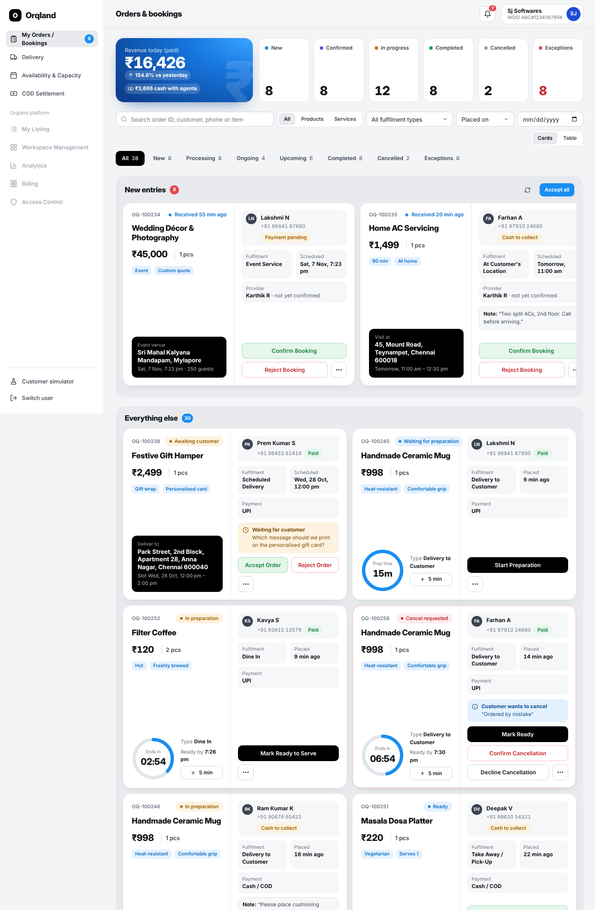

# Orqland — Order Management Module

Order & booking management for the Orqland platform (OpenPurpl Technologies): products and services, all 11 fulfilment types, review → preparation/scheduling → delivery or service → payment → completion, with exceptions, payment tracking and COD reconciliation.

Built as a standalone module (Next.js + React + TypeScript, NestJS, PostgreSQL) with sample data, ready to integrate into the confidential Orqland codebase.



## What's inside

| | |
|---|---|
| **Workspace Admin** (`/admin`) | Summary cards (new, confirmed, in progress, completed, cancelled, exceptions) + revenue, Figma-style order cards or table, “New entries” lane with **Accept all**, filters (products/services, fulfilment type, date, search by ID/customer/phone/item), order detail with progress stepper, every contextual action, payment/COD and full audit timeline |
| **Delivery** (`/admin/delivery`) | Needs an agent · Waiting for agent (offer countdown) · On the way · Failed & returns, agent roster with duty status and load |
| **Availability & capacity** (`/admin/schedule`) | Delivery windows, pickup windows, service slots and workshop sessions by day: capacity meters, add slot, change capacity (never below bookings), close/reopen, attendees, complete workshop session |
| **COD settlement** (`/admin/settlements`) | Outstanding cash by agent and by order, handovers to verify, confirm / record discrepancy / resolve, settled history |
| **Delivery Agent app** (`/agent`) | Offers with expiry timer, active deliveries with every step (navigate, call, pickup, start, delivered/failed, return), cash in hand and handover, history, on/off duty |
| **Service Provider app** (`/provider`) | Today / upcoming / to-do / past bookings: confirm, start travel, attended, start, complete, customer unavailable, failed session, request rescheduling, meeting details |
| **Customer simulator** (`/admin/simulator`) | Demo-only: place any order type as a customer, request cancel / reschedule / return, reply to clarifications, simulate payment success/failure |

The workflow engine (`backend/src/domain/engine.ts`) is the single source of truth: each order returned by the API carries the exact `actions` the current user may take for its fulfilment type and statuses, so the UI never shows a button the backend would refuse.

## Run it

```bash
docker compose up --build
# web  http://localhost:3000   → pick a demo user
# api  http://localhost:4000/api/v1   → Swagger at /api/docs
```

Without Docker see [docs/DEPLOYMENT.md](docs/DEPLOYMENT.md) (`npm install`, `npm run db:migrate`, `npm run db:seed`, `npm run start:dev`, `npm run dev`).

Demo users: **Sanjay J** (admin), **Ravi Kumar / Suresh M / Arun P** (agents), **Priya S / Karthik R / Meena V** (providers). The seed contains 38 orders and bookings covering every fulfilment type and every dashboard state.

## Tests

```bash
cd backend
npm run test:unit                                    # 27 workflow-engine tests
TEST_DATABASE_URL=postgres://…/orqland_om_test npm run test:e2e   # 23 integration tests on PostgreSQL
```
All 50 pass. The integration suite covers concurrency (no overselling, no overbooking, one winner when two admins accept at once), offer expiry and auto re-offer, failed delivery → return → reschedule, provider conflicts, payment retries and idempotent webhooks, and the full COD handover/discrepancy flow.

## Documentation

| Doc | |
|---|---|
| [Requirements traceability](docs/REQUIREMENTS_TRACEABILITY.md) | Every requirement in the brief → where it's implemented and how it was verified, plus open questions for OpenPurpl |
| [Status definitions & workflows](docs/STATUS_DEFINITIONS.md) | The four separate statuses (+ refund), per-type workflows, cancellation rules, exceptions |
| [API reference](docs/API.md) | Contracts, payloads, errors, idempotency, concurrency |
| [Action matrix](docs/ACTION_MATRIX.md) | Every action code and which roles may use it |
| [Data model](docs/DATA_MODEL.md) | Tables, constraints, migrations, sample data |
| [Integration guide](docs/INTEGRATION_GUIDE.md) | How to plug into Orqland: auth, catalogue, checkout, payments, notifications, GPS, frontend |
| [Setup & deployment](docs/DEPLOYMENT.md) | Local setup, tests, Docker, production checklist |

## Scope notes

Live GPS tracking, external notification providers, payment gateway, refund processing and customer-facing UI must be agreed with OpenPurpl first (brief §11). Each has a ready integration point (see the integration guide); none ships a third-party integration.

## Project layout

```
backend/
  src/domain/        workflow engine, statuses, per-type workflows (framework-free, unit-tested)
  src/orders/        list/detail queries, action executor, order creation
  src/delivery/      assignment strategy, admin board, agent & provider endpoints
  src/schedule/      availability, capacity, workshop sessions
  src/settlements/   COD collection, handovers, discrepancies
  src/payments/      verified payment events (webhook)
  src/notifications/ in-app notifications + channel interface
  src/simulator/     demo-only customer API
  migrations/        SQL migrations     seeds/  sample data     test/  unit + integration
frontend/
  src/app/           pages: sign-in, admin (orders, delivery, schedule, settlements, simulator), agent, provider
  src/components/    order card, detail, action bar & dialogs, shells, UI primitives
  src/lib/           API client, hooks, formatting, types
docs/                documentation and screenshots
```
